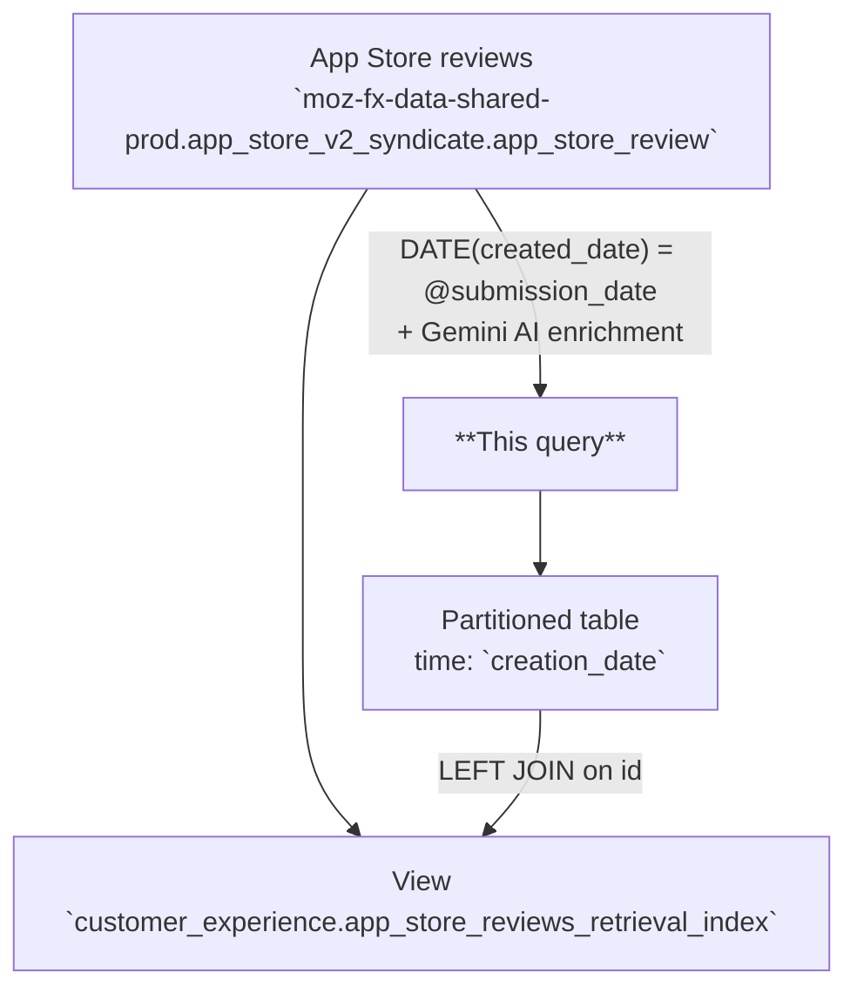

# App Store Reviews Retrieval Index

AI-enriched retrieval table derived from Apple App Store reviews of Mozilla apps, one row per review. Stores Gemini-generated summaries, classifications, sentiment scores and vector embeddings to support semantic search and grounded question answering over app store reviews.

---

## 📌 Overview

| | |
|---|---|
| **Grain** | One row per `id` |
| **Source** | `moz-fx-data-shared-prod.app_store_v2_syndicate.app_store_review` |
| **DAG** | `bqetl_customer_experience` · daily · incremental |
| **Partitioning** | `creation_date` *(partition filter not required)* |
| **Clustering** | None |
| **Retention** | No automatic expiration |
| **Owner** | lvargas@mozilla.com |
| **Version** | v1 (initial version) |

**Use cases:** app review analysis · semantic search via embeddings · sentiment trend monitoring

---

## ⚠️ Analysis Caveats

- **Query the view, not this table.** `customer_experience.app_store_reviews_retrieval_index` joins this table to the source reviews on `id` and adds `app_id`, `territory` and `rating`. This table stores only the fields the LLM needs (`id`, `creation_date`, `title`, `body`) plus the AI fields.
- **`title` and `body` here are the text the LLM saw.** The view reads the current text from the source table, which Fivetran can update after the partition was written.
- **Each partition is written once.** Later edits to a review are not re-analysed unless the partition is re-run.
- **The view includes reviews not yet indexed.** It LEFT JOINs this table onto the source, so LLM fields, `embedding` and `metadata` are NULL for reviews this table has not processed.
- **Filter on individual LLM columns when you need clean values.** Each LLM column can be NULL or empty independently; filter `WHERE <col> IS NOT NULL` (and `ARRAY_LENGTH(<col>) > 0` for arrays).
- **`review_category_llm` is constrained to five values** (`complaint`, `bug`, `request`, `praise`, `question`). Any other value the model returns is kept and tagged `review_category_llm_not_allowed` in `metadata.failure_reasons`.
- **`review_sentiment_score` is NULLed at write time when out of range.** `metadata.failure_reasons` distinguishes `review_sentiment_score_missing` from `review_sentiment_score_out_of_range`.
- **For vector search, filter `embedding IS NOT NULL`.** The view does not filter rows without an embedding.
- **Always embed query text with `gemini-embedding-001`.** Mixing embedding models produces meaningless distances.

---

## 🗺️ Data Flow



---

## 🧠 How It Works

1. **Input** — reviews created on `@submission_date`; `IFNULL(title, '')` and `IFNULL(body, '')` are used as LLM input.
2. **AI generation** — `AI.GENERATE` with `gemini-3.8-flash` produces summary, category, language, entities, topics and sentiment score per review. The prompt puts the review text first and the instructions last.
3. **Embedding** — `AI.EMBED` with `gemini-embedding-001` generates a dense vector from the concatenated `title` and `body`.
4. **Metadata** — a struct captures input fields, model versions, prompt version, analysis timestamp, embedding status and `failure_reasons`.

---

## 🧩 Example Queries

```sql
-- 1. Review volume and average sentiment by category over the last 30 days
SELECT
  review_category_llm,
  COUNT(*) AS review_count,
  AVG(review_sentiment_score) AS avg_sentiment
FROM `moz-fx-data-shared-prod.customer_experience.app_store_reviews_retrieval_index`
WHERE creation_date >= TIMESTAMP(DATE_SUB(CURRENT_DATE(), INTERVAL 30 DAY))
  AND review_category_llm IS NOT NULL
GROUP BY 1
ORDER BY review_count DESC;
```

```sql
-- 2. Semantic search: 10 reviews most similar to a free-text query
SELECT
  base.id,
  base.title,
  base.review_summary_llm,
  distance
FROM
  VECTOR_SEARCH(
    (
      SELECT *
      FROM `moz-fx-data-shared-prod.customer_experience.app_store_reviews_retrieval_index`
      WHERE embedding IS NOT NULL
    ),
    'embedding',
    (
      SELECT
        AI.EMBED('ad blocker not working', endpoint => 'gemini-embedding-001').result AS embedding
    ),
    query_column_to_search => 'embedding',
    top_k => 10,
    distance_type => 'COSINE'
  )
ORDER BY distance ASC;
```

```sql
-- 3. Triage: which checks are firing most often?
SELECT
  reason,
  COUNT(*) AS row_count
FROM `moz-fx-data-shared-prod.customer_experience_derived.app_store_reviews_retrieval_index_v1`,
  UNNEST(metadata.failure_reasons) AS reason
WHERE creation_date >= TIMESTAMP(DATE_SUB(CURRENT_DATE(), INTERVAL 7 DAY))
GROUP BY 1
ORDER BY row_count DESC;
```

---

## 📋 Change Control

### Prompt version log

| `prompt_version` | Date | Summary |
|---|---|---|
| `v1` | 2026-11-16 | Initial — summary (8 words), category (one of 5), language (BCP 47), entities (×3), topics (×3), sentiment score |

### When to update

| What changed | Field to update in `query.sql` |
|---|---|
| Prompt text or `output_schema` in `AI.GENERATE` | `prompt_version` — increment to `v2`, `v3`, … |
| Generative model (currently `gemini-3.8-flash`) | `llm_model` |
| Embedding model (currently `gemini-embedding-001`) | `embedding_model` + re-embed full history |

---

## 🗃️ Schema & Related Tables

- Full field definitions: [`schema.yaml`](schema.yaml)
- **Upstream**: `moz-fx-data-shared-prod.app_store_v2_syndicate.app_store_review` — Apple App Store reviews (Fivetran)
- **Downstream**: `moz-fx-data-shared-prod.customer_experience.app_store_reviews_retrieval_index` (view, also published to `mozdata`)
